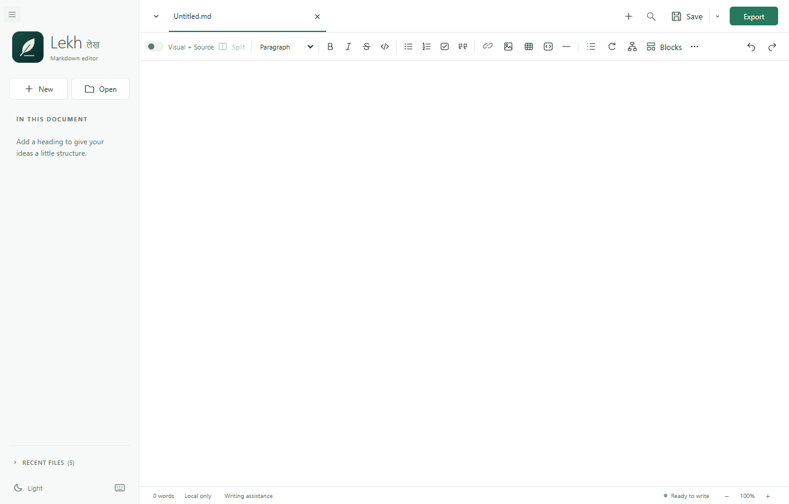
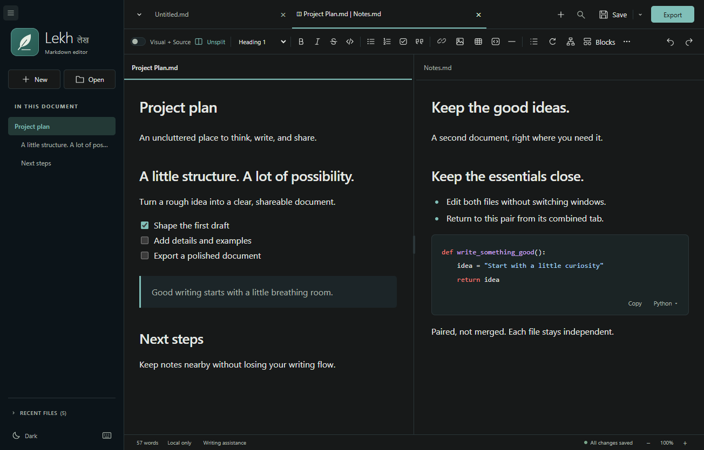

# Lekh लेख

**Lekh: Markdown editor** is a calm, local-first Windows Markdown editor with editable **Visual + Source**, paired split tabs, offline Mermaid diagrams, and **Word/PDF export**.

**Development version: 0.8.0 — not yet published.** This checkout establishes Lekh as an independent product with its own application, installer, and settings identities. No settings, recovery data, or installation identities are imported from another product.

**[Current stable download: Lekh 0.7.1 for Windows x64 (.exe)](https://github.com/dennispadia/lekh/releases/download/v0.7.1/Lekh-Markdown-editor-Setup-0.7.1-x64.exe)** · [Stable release notes and source ZIP](https://github.com/dennispadia/lekh/releases/tag/v0.7.1) · [User guide](docs/USER_GUIDE.md)

The published 0.7.1 assets remain unchanged. The fresh identities described here apply to the **0.8.0 development checkout**, not to the existing stable binary. No 0.8.0 installer is available from the stable link.

Free to use and modify under the [MIT license](LICENSE). **[Open a GitHub issue](https://github.com/dennispadia/lekh/issues)** for bugs, enhancements, and requests. There is no guaranteed response time, resolution, or future maintenance commitment. See [SUPPORT.md](SUPPORT.md).

## Writing features

| Area | Included tools |
| --- | --- |
| **Markdown editing** | Headings, bold, italics, strikethrough, lists, tasks, quotes, links, images, rules, and code blocks. Use Visual for formatted writing or Source for exact Markdown and unsupported syntax. |
| **Visual + Source** | Two editable views of one document, with a shared toolbar. Source-only and read-only Source + Preview are also available. |
| **Paired split tabs** | Keep two independent documents side by side; commands target the active document. Resize the divider or unsplit without closing files. |
| **Responsive interface** | One formatting toolbar, More tools and views overflow, shrinking tabs, an Open documents list, and a collapsible sidebar. |
| **Links and tables** | Edit link text/addresses in place, remove links without deleting text, choose table dimensions, and add/remove table rows and columns. |
| **Code and diagrams** | Search the offline language catalog, highlight code, copy raw code, and insert editable Mermaid diagrams at the current selection. Code is displayed, never executed. |
| **Find/Replace** | Match case, Unicode whole words, regex, match counts, navigation, and replacement. |
| **Writing assistance** | Optional offline English grammar checks powered by the bundled Harper engine. Review, apply, ignore, or ignore a suggestion throughout the current document. No text is sent online or changed automatically. |
| **Word and PDF export** | Export the active document, including unsaved edits, with an explicit heading hierarchy, formatted links, aligned tables, nested lists, task boxes, syntax-colored code, supported images, and Mermaid diagrams. Export does not save the Markdown. |
| **Workspace** | Light/Dark themes, a resizable sidebar, heading outline, five recent files, zoom controls, word count, and Focus mode (F9). |
| **Safeguards** | Unsaved-change prompts, external-edit detection, atomic saves, recovery drafts, Save As, and Save All. Recovery is not a backup. |
| **Keyboard and context menus** | Formatting/file shortcuts, contextual editing commands, spelling suggestions, and an F1 keyboard reference. |

Switching between Visual and Source resets that tab's undo history; switching tabs preserves it. Source + Preview uses the Source history.

### Richer exports in development 0.8.0

- **Explicit typography:** Segoe UI Heading 1–6 sizes, weights, spacing, and colors are defined by Lekh rather than a document consumer's default heading styles. Bold, italic, and strikethrough are preserved; hyperlinks are colored and underlined.
- **Navigation:** Word exports include heading bookmarks and clickable internal heading links, including table-of-contents links. PDFs include document bookmarks and tagged accessibility.
- **Structure:** page-width fixed tables preserve Markdown column alignments and use shaded, repeating header rows. Nested lists retain continuation paragraphs and numbering starts; task lists render checked/unchecked boxes.
- **Code and images:** syntax colors, blank lines, and tabs are preserved in code blocks. Supported images keep their aspect ratio and fit within page bounds.
- **Print layout:** A4 pages with 20 mm margins and readable light print colors, regardless of the editor's Light/Dark theme.

Word output remains editable and reflows in the receiving application; Word and PDF are **not pixel-identical**. Math, footnotes, and YAML do not have formatted rendering or structured export support. See [export details and limitations](docs/USER_GUIDE.md#images-and-exports).

## Screenshots

The following captures show the Lekh interface with sample documents, not personal files.





## Install on Windows

Requires **Windows 10/11 x64 and .NET Framework 4.8 or newer**, normally included in Windows. Other operating systems and architectures are not packaged or tested.

For a published installer, use the **[stable 0.7.1 release](https://github.com/dennispadia/lekh/releases/tag/v0.7.1)**. Its EXE, [checksums](https://github.com/dennispadia/lekh/releases/download/v0.7.1/SHA256SUMS.txt), and source ZIP remain unchanged. This source checkout is development 0.8.0 and requires building locally.

For a verified installer built from this checkout:

1. Save and close any running Lekh, then choose **Install Lekh** in setup.
2. Setup installs only for your current Windows user, without requesting administrator access.
3. Open **Lekh** from the desktop or Start menu.

The offline setup embeds the runtime and internal MSI; recipients do not need Node.js, npm, Word, Pandoc, or an account. Installation does not wait for the accessible, reduced-motion-aware origin story.

### Independent development identities

- Application ID: `com.lekh.desktop`; npm package: `lekh`.
- Application files: `%LOCALAPPDATA%\lekh`; executable: `Lekh - Markdown editor.exe`.
- Preferences, recent files, Chromium storage, and recovery drafts: `%APPDATA%\Lekh`.
- Setup cache/logs: `%LOCALAPPDATA%\Lekh\SetupCache` and `%LOCALAPPDATA%\Lekh\SetupLogs`.
- MSI upgrade code: `DCBCF7FA-11DA-4F35-8D27-D066EEC6C582`. Keep it stable for future Lekh upgrades.

Lekh uses a fresh standalone profile and installation directory. Existing drafts and preferences are **not automatically imported**; saved Markdown files can be opened normally. It does not migrate aliases or replace/uninstall another product. Close Lekh before a future Lekh upgrade; setup asks rather than force-closing the editor. Real upgrade/repair testing remains necessary before publishing a new installer.

**Unsigned software:** application, setup EXE, and internal MSI are not code-signed. Windows, browser, or organization policies may warn about or block them. Verify checksums and follow your organization's policies; do not disable security protections. See [signing status](docs/PUBLISHING.md#code-signing-policy-pending).

Uninstall through **Windows Settings > Apps > Installed apps**. Your Markdown documents are not installer-managed files. The separate settings/recovery profile is not intentionally deleted on uninstall.

## Start writing

1. Start in blank **Untitled**, open a `.md` file, or choose **New**.
2. Write in **Visual**, or enable **Visual + Source**. Source-only and Source + Preview are under **More (...)** and View.
3. Use **Ctrl+F** to search, **Ctrl+T** for a table, or **F1** for shortcuts.
4. Save Markdown with **Ctrl+S**; the Save arrow provides Save All and Save As.
5. Use **Export** for a separate Word or PDF document.

See the [user guide](docs/USER_GUIDE.md) for recovery, images, shortcuts, and limitations.

## Build and contribute

With Windows x64 and Node.js >=22.15.0 (the workflow uses 22.22.0):

```powershell
npm.cmd ci --registry=https://registry.npmjs.org
npm.cmd run build
.\node_modules\.bin\electron.cmd .
```

Or double-click `Launch.cmd` in a source checkout. If no packaged build exists, its setup script downloads a checksum-verified private Node runtime and builds the app.

See [BUILDING.md](docs/BUILDING.md) for tests and packaging, [PUBLISHING.md](docs/PUBLISHING.md) for release verification, and [CONTRIBUTING.md](CONTRIBUTING.md) for focused changes.

## Boundaries and privacy

Documents stay on your computer. There are no accounts, document uploads, cloud sync, or analytics. Remote images are not downloaded; opening an external web/email link requires confirmation and uses another application. Developer setup downloads tools and dependencies, not your documents.

Visual editing may normalize Markdown; use Source for unsupported syntax. Math rendering, automatic updates, cloud sync, and custom export templates are not included. Keep backups: recovery is not a backup.
