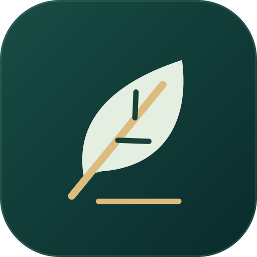
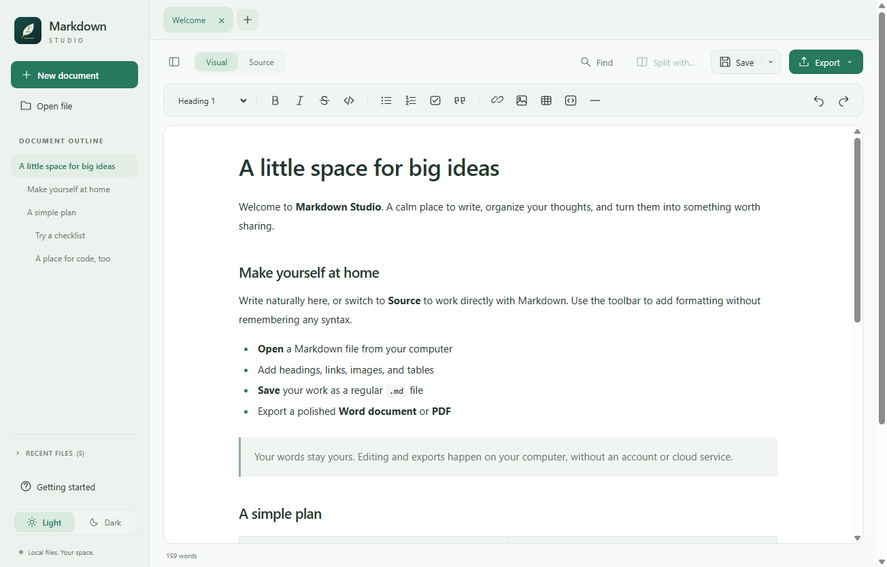
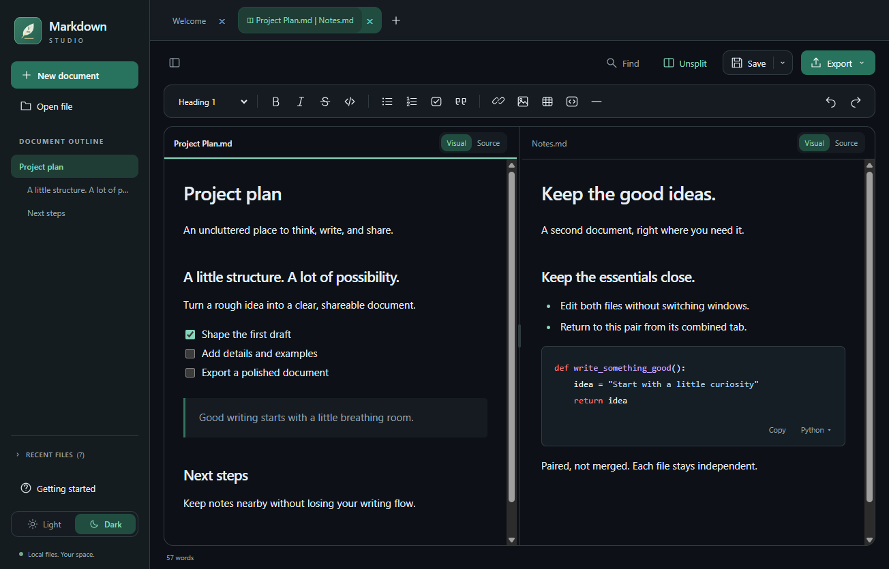

# Markdown Studio

A calm, local-first **Windows Markdown editor** with friendly visual editing, a source editor, paired split tabs, and **Word/PDF export**.

**Free to use, modify, and fork under MIT. Shared as-is, with no support or promised maintenance.** Want another feature? Fork the project and build it yourself, optionally with an AI coding assistant. See [SUPPORT.md](SUPPORT.md) and [CONTRIBUTING.md](CONTRIBUTING.md).

## See it in action

These are screenshots of the actual desktop application, using sample documents.

### Light: a focused writing space



### Dark: two documents, one paired tab



## Features

- **Visual and Source editing:** format naturally or edit the exact Markdown.
- **Multiple files and paired split tabs:** two files share one tab; other tabs remain independent. Each pane has its own mode, selection, scroll position, and undo.
- **Markdown tools:** headings, bold, italics, lists, tasks, tables, links, images, quotes, and code blocks.
- **Offline syntax highlighting:** searchable code-language selection and per-block Copy.
- **Word and PDF export:** no Microsoft Word or Pandoc installation required.
- **Light/Dark themes:** teal accents, a collapsible sidebar, and collapsible recent history that leaves room for the outline.
- **Keyboard shortcuts:** hover over controls, inspect menu hints, or press **F1**.
- **Local safeguards:** unsaved-change prompts, external-edit detection, atomic saves, and recovery drafts.
- **No account, cloud sync, document uploads, or analytics.**

## Install on Windows

**Windows 10/11, x64.** Other operating systems and architectures are not packaged or tested.

1. Download `Markdown-Studio-<version>-x64.msi` from this repository's **Releases** page, once published.
2. Double-click the MSI to install for your current Windows user.
3. Open **Markdown Studio** from the desktop or Start menu.

The MSI contains the desktop runtime: recipients do **not** need Node.js, npm, Word, Pandoc, or the source code. Share the MSI itself, not just the executable from a developer build.

**Unsigned software:** the application and MSI are not code-signed. Windows, browser, or organization policies may warn about or block them. An installer does not remove those warnings. Only install artifacts you trust, verify the published SHA-256 checksum, and follow your organization's policies; do not disable security protections.

Uninstall through **Windows Settings > Apps > Installed apps**. Your Markdown documents are not installer-managed files. The app does not intentionally delete its separate settings/recovery profile on uninstall.

## Start writing

Open a `.md` file or choose **New document**, write in **Visual** or **Source**, then save. **Export** creates a separate `.docx` or `.pdf`; it does not save the Markdown file. The **Save** arrow provides Save All and Save As.

Use the [complete user guide](docs/USER_GUIDE.md) for tables, images, split panes, recovery, shortcuts, and export limitations.

## Build or customize a fork

With Windows x64 and **Node.js 22.15 or newer** (the checked workflow uses Node 22.22.0):

```powershell
npm.cmd ci --registry=https://registry.npmjs.org
npm.cmd run build
.\node_modules\.bin\electron.cmd .
```

Or double-click `Launch.cmd` in a source checkout. If no packaged build exists, its setup script downloads a checksum-verified private Node runtime and builds the app.

See [BUILDING.md](docs/BUILDING.md) for tests, installer builds, source archives, and architecture. See [PUBLISHING.md](docs/PUBLISHING.md) to put your copy on GitHub and publish release downloads.

## Boundaries and privacy

This is not complete Typora parity. Visual editing may normalize Markdown; use Source for unsupported syntax. Math/Mermaid rendering, automatic updates, cloud sync, and custom export templates are not included. Recovery is not a backup.

Documents stay on your computer. Remote images are not downloaded. Opening an external web/email link requires confirmation and uses another application. Development dependencies and build tools require internet access. See the [user guide](docs/USER_GUIDE.md#privacy).

## License and support

- [MIT license](LICENSE): permits use, modification, redistribution, and forks, subject to its terms.
- [Third-party notices](THIRD_PARTY_NOTICES.md): dependencies retain their own licenses.
- [No support](SUPPORT.md): no help desk, response commitment, or promised fixes.
- [Forking guidance](CONTRIBUTING.md): independent, AI-assisted customization is welcome; upstream contributions are not being solicited.
