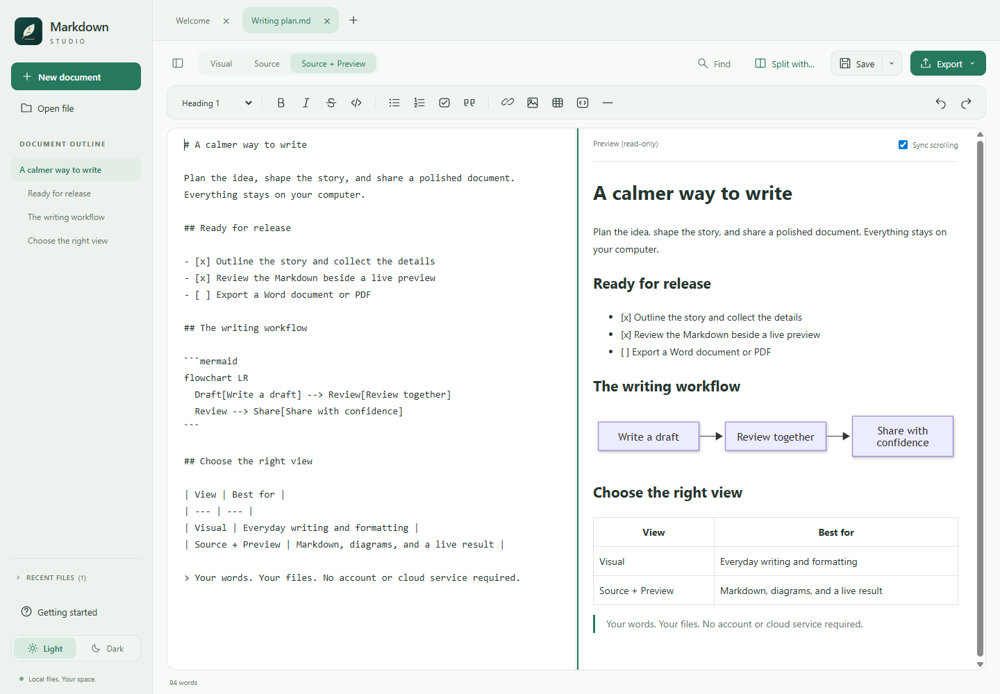
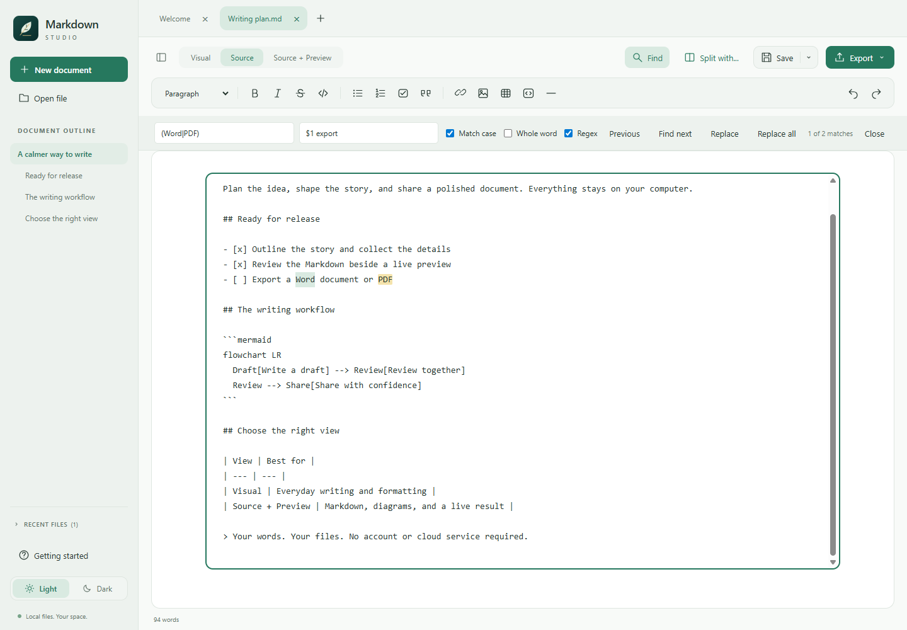

# Markdown Studio

A calm, local-first **Windows Markdown editor** with visual editing, **Source + Preview**, paired split tabs, offline Mermaid diagrams, and **Word/PDF export**.

**[Download the Windows x64 installer (0.6.1)](https://github.com/dennispadia/MarkdownStudio/releases/download/v0.6.1/Markdown-Studio-0.6.1-x64.msi)** · [Release notes and source ZIP](https://github.com/dennispadia/MarkdownStudio/releases/tag/v0.6.1) · [User guide](docs/USER_GUIDE.md)

The installer includes the desktop runtime. No Node.js, Word, Pandoc, or account is required. **The installer is unsigned; Windows or your browser may show a warning.**

**Free to use, modify, and fork under MIT. Shared as-is, with no support or promised maintenance.** Want another feature? Fork the project and build it yourself, optionally with an AI coding assistant. See [SUPPORT.md](SUPPORT.md) and [CONTRIBUTING.md](CONTRIBUTING.md).

## What's new in 0.6.1

- Double-clicking an associated Markdown file in Windows Explorer opens that file, rather than only the Welcome screen.
- Further Explorer launches reuse the existing window and open files in tabs. An already-open file is focused without replacing unsaved edits; minimized windows are restored.
- File requests wait until the editor is ready or its current operation finishes. Unreadable files report an error without blocking other requested files.

Close Markdown Studio before upgrading with the new MSI. If Windows no longer remembers your `.md` default, choose **Open with > Choose another app > Markdown Studio** again.

### Included from 0.6.0

All five additions below remain included in the **0.6.1 installer**, not just the source checkout.

| Feature | What you can do |
| --- | --- |
| **Source + Preview** | Edit Markdown alongside a read-only live rendering of the same document. Optionally synchronize scrolling in either direction. Each side of a two-file pair can also use this mode. |
| **Enhanced Find/Replace** | Search with match-case, Unicode whole-word, or regex options. Navigate Previous/Next, see counts and Source highlights, and replace the current match or all matches. Regex replacements support capture groups; expensive searches stop after two seconds instead of blocking the editor. |
| **Refreshable table of contents** | Use **Insert > Table of contents**, then **Insert > Update table of contents** after changing headings. The marked contents block keeps its links up to date without replacing surrounding source. Duplicate headings receive distinct anchors. |
| **Image storage choice** | Insert, paste, or drop a supported image, then choose an embedded image or a relative file in the document's **assets** folder. Save the document first to use relative assets; keep that folder with the Markdown when sharing. |
| **Offline Mermaid diagrams** | Use **Insert > Mermaid diagram** for a starter, or write a fenced `mermaid` block. Supported diagrams render locally in Visual and Preview and become images in Word/PDF exports. Invalid or unsupported diagrams show an explicit error. |

See the [user guide](docs/USER_GUIDE.md#editing-features) for search options and limits, and [Mermaid diagrams](docs/USER_GUIDE.md#mermaid-diagrams) for supported diagram families and restrictions.

## See 0.6.0 in action

Fresh captures of the actual **0.6.0 desktop application**, using sample documents in an isolated profile. These are app screenshots, not mockups; no personal documents are shown.

### Source + Preview: Markdown and the result together

The editable source is on the left; the read-only preview on the right renders the table and Mermaid flowchart. **Sync scrolling** can be turned off.



### Visual writing: checklists, formatting, and diagrams

Write naturally in Light theme with the document outline, interactive task checkboxes, formatting controls, and editable Mermaid source with its rendered diagram.


### Dark: two documents, one paired tab

Keep reference notes beside a draft. Both panes are editable and have independent mode controls; Find, Save, Export, and the outline follow the active pane.


### Find/Replace: navigate and edit with confidence

This example searches for `Word` or `PDF` with a regex, shows both matches in Source, and prepares a capture-group replacement without changing the document.



## More writing features

| Area | Included tools |
| --- | --- |
| **Markdown editing** | Headings, bold, italics, strikethrough, lists, tasks, quotes, links, images, horizontal rules, and code blocks. Use Visual for formatted writing or Source for exact Markdown and unsupported syntax. |
| **Tables** | Choose rows and columns in the Insert table dialog from the toolbar, right-click menu, or **Ctrl+T**. Add/remove rows and columns in Visual mode. |
| **Code blocks** | Search the offline language catalog by name or alias, apply syntax highlighting, and copy a block's raw code. Code is displayed, never executed. |
| **Tabs and paired views** | Open multiple documents; use thumbnail cards to pick a split partner. Resize the divider, work independently in each pane, or unsplit without closing files. Each tab keeps its own selection, scroll position, and undo history. |
| **Word and PDF export** | Export the active document, including unsaved edits, supported images, syntax-highlighted code, and supported Mermaid diagrams. Export creates a separate file; it does not save the Markdown. |
| **Workspace and navigation** | Light/Dark themes, a resizable/collapsible sidebar with remembered width, a clickable heading outline, collapsible recent files, word count, and Focus mode (**F9**). |
| **Keyboard and context menus** | Formatting and file shortcuts, a right-click Markdown menu, tooltips with shortcut hints, and an **F1** keyboard reference. |
| **File safeguards** | Unsaved-change prompts, external-edit detection, atomic saves, recovery drafts, Save As, and Save All. Recovery is not a backup. |
| **Local-first privacy** | No account, document uploads, cloud sync, or analytics. Remote images are not downloaded; opening an external web/email link requires confirmation. |

Switching between Visual and Source resets that tab's undo history; switching tabs preserves it. Source + Preview uses the Source history, so returning to Source keeps that history.

## Install on Windows

**Windows 10/11, x64.** Other operating systems and architectures are not packaged or tested.

**Release status:** **0.6.1** includes the Explorer-opening fix and the features shown above. This release is unsigned while trusted code-signing approval is pending; see the [code signing policy and preparation status](docs/PUBLISHING.md#code-signing-policy-pending).

1. **[Download the Windows x64 MSI installer (0.6.1)](https://github.com/dennispadia/MarkdownStudio/releases/download/v0.6.1/Markdown-Studio-0.6.1-x64.msi)**, or open [Releases](https://github.com/dennispadia/MarkdownStudio/releases) for all downloads and release notes.
2. Double-click the MSI to install for your current Windows user.
3. Open **Markdown Studio** from the desktop or Start menu.

The MSI contains the desktop runtime: recipients do **not** need Node.js, npm, Word, Pandoc, or the source code. Share the MSI itself, not just the executable from a developer build.

The installer is attached to the GitHub Release, not stored among the source files. [SHA-256 checksums](https://github.com/dennispadia/MarkdownStudio/releases/download/v0.6.1/SHA256SUMS.txt) and a clean source ZIP are available with the release.

**Unsigned software:** the application and MSI are not code-signed. Windows, browser, or organization policies may warn about or block them. An installer does not remove those warnings. Only install artifacts you trust, verify the published SHA-256 checksum, and follow your organization's policies; do not disable security protections.

Uninstall through **Windows Settings > Apps > Installed apps**. Your Markdown documents are not installer-managed files. The app does not intentionally delete its separate settings/recovery profile on uninstall.

## Start writing

1. Open a `.md` file or choose **New document**.
2. Choose **Visual** for formatted editing, **Source** for Markdown text, or **Source + Preview** to see both the source and its read-only rendering.
3. Use **Ctrl+F** to search, **Ctrl+T** to insert a table, or **F1** for the keyboard reference.
4. Save the Markdown with **Ctrl+S**. The **Save** arrow provides Save All and Save As.
5. Use **Export** to create a separate `.docx` or `.pdf` when ready to share.

Use the [complete user guide](docs/USER_GUIDE.md) for tables, images, split panes, recovery, shortcuts, and export limitations.

## Build or customize a fork

With Windows x64 and **Node.js 22.15 or newer** (the checked workflow uses Node 22.22.0):

```powershell
npm.cmd ci --registry=https://registry.npmjs.org
npm.cmd run build
.\node_modules\.bin\electron.cmd .
```

Or double-click `Launch.cmd` in a source checkout. If no packaged build exists, its setup script downloads a checksum-verified private Node runtime and builds the app.

See [BUILDING.md](docs/BUILDING.md) for tests, installer builds, source archives, and architecture. See [PUBLISHING.md](docs/PUBLISHING.md) to put your copy on GitHub and publish release downloads.

## Boundaries and privacy

Visual editing may normalize Markdown; use Source for unsupported syntax. Math rendering, automatic updates, cloud sync, and custom export templates are not included. Recovery is not a backup.

Documents stay on your computer. Remote images are not downloaded. Opening an external web/email link requires confirmation and uses another application. Development dependencies and build tools require internet access. See the [user guide](docs/USER_GUIDE.md#privacy).

## License and support

- [MIT license](LICENSE): permits use, modification, redistribution, and forks, subject to its terms.
- [Third-party notices](THIRD_PARTY_NOTICES.md): dependencies retain their own licenses.
- [No support](SUPPORT.md): no help desk, response commitment, or promised fixes.
- [Forking guidance](CONTRIBUTING.md): independent, AI-assisted customization is welcome; upstream contributions are not being solicited.
